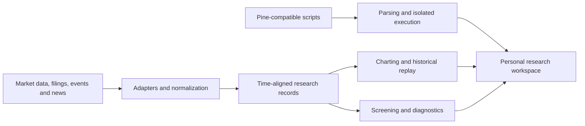

[English](README.md) | [简体中文](README_ZH.md) | [日本語](README_JA.md)

# NuvexLens

### Personal Quant Research Workbench

An engineering workspace for personal quantitative research across charting, historical replay, market-data workflows, and script experimentation.

[Project Site](https://nuvexlens.com) · [Chart & Replay](https://chart.nuvexlens.com/) · [Documentation](https://docs.nuvexlens.com)

---

> **Project scope:** NuvexLens is a personal quantitative research and engineering workbench, not a commercial SaaS product, paid signal service, investment adviser, broker, or execution venue. This repository is a public architecture showcase with selected, sanitized material. Core model logic, credentials, personal data, production configuration, and source-specific pipeline details are kept in private environments.

## Overview

NuvexLens brings together multi-market charting, historical replay, research data workflows, screening, and script experimentation. The focus is the engineering of a repeatable personal research process, rather than publishing trade recommendations or proprietary factor recipes.

## Conceptual Architecture

This is a logical overview, not a deployment diagram. It omits provider endpoints, database schemas, model formulas, and production topology.

## Engineering Focus

### Charting and replay

- Synchronized chart views for comparing instruments and timeframes.
- Historical replay with stepwise and variable-speed controls.
- Blind replay can mask instrument and date context to reduce hindsight bias. It is a research control, not a claim that every calculation is free of look-ahead effects.

### Research data workflows

- Normalize market, regulatory-filing, event, and news inputs for research use.
- Preserve the distinction between source data, derived observations, and evaluation results.
- Keep source-specific adapters, private schemas, feature definitions, and factor weights out of this showcase.

### Script experimentation

- Parse and translate Pine-compatible scripts for an isolated execution path.
- Keep proprietary indicator logic and production execution details private.

### Historical evaluation

- Review research hypotheses against historical data and tracked outcomes.
- Treat simulation results as research evidence, not as a promise of future performance.

## Public Repository Scope

This repository is limited to project descriptions, conceptual architecture, and selected sanitized demonstrations. Before adding screenshots or recordings, remove account identifiers, personal watchlists, private positions, session information, and other non-public data.

This repository has no repository-wide open-source code license. Public visibility alone does not grant reuse rights; third-party components and scripts remain subject to their respective terms and licenses.

## Disclaimer

NuvexLens is for personal quantitative research and engineering practice. Its materials are research tools and simulations, not personalized investment advice, brokerage, trade execution, or a paid public signal subscription. They do not guarantee investment outcomes.

The charting experience incorporates TradingView Charting Library and related components under their applicable terms. Thanks to the TradingView team and the wider script-author community for their work.

---

**NuvexLens** — Personal Quant Research Workbench

Copyright © 2024-2026 NuvexLens. All rights reserved.

