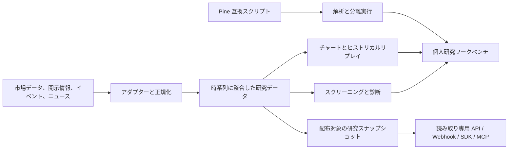

[English](README.md) | [简体中文](README_ZH.md) | [日本語](README_JA.md)

# NuvexLens

### 個人向けクオンツ研究ワークベンチ

複数市場のチャート、ブラインドリプレイ、研究データ基盤、開発者向け接続を紹介する、個人クオンツ研究のエンジニアリング・ショーケースです。

[プロジェクトサイト](https://nuvexlens.com) · [チャートとリプレイ](https://chart.nuvexlens.com/) · [ドキュメント](https://docs.nuvexlens.com)

---

> **プロジェクトの位置づけ:** NuvexLens は個人のクオンツ研究とエンジニアリング実践のためのワークベンチです。商用 SaaS、有料シグナル配信、投資助言、証券仲介、取引執行サービスではありません。このリポジトリでは、選別・匿名化した設計資料とデモを公開します。コアモデルのロジック、認証情報、個人データ、本番設定、データソース固有のパイプライン詳細はプライベート環境で管理します。

## 概要

NuvexLens は、複数市場のチャート、ヒストリカルリプレイ、研究データ処理、スクリーニング、スクリプト検証を個人の研究ワークフローにまとめます。取引推奨や独自ファクターの公開ではなく、再検証可能な研究プロセスのエンジニアリングに重点を置いています。

## 概念アーキテクチャ

これは論理的な関係を示す図であり、本番環境のデプロイ構成ではありません。データ提供元の URL、データベーススキーマ、モデル式、本番構成は含みません。

## エンジニアリング領域

### チャートとリプレイ

- 複数のチャートビューを連携し、銘柄や時間軸を比較できます。
- ヒストリカルリプレイ、ステップ再生、再生速度の調整に対応します。
- ブラインドリプレイでは銘柄名や日付の情報を隠し、後知恵バイアスを抑えます。これは研究上の制御であり、すべての計算で先読みが発生しないことを証明するものではありません。

### 研究データワークフロー

- 市場データ、規制当局への提出書類、イベント、ニュースなどの異種データを研究向けに正規化します。
- ソースデータ、派生データ、評価結果を区別して扱います。
- ソース固有のアダプター、非公開スキーマ、特徴量定義、ファクターの重みは公開しません。

### スクリプト検証

- Pine 互換スクリプトを解析・変換し、分離された実行経路で検証します。
- 独自インジケーターのロジックと本番実行の詳細はプライベート環境で管理します。

### 過去データ評価とシャドーモード（Shadow Mode）

- 時点を整合させた過去サンプルと、その後の追跡記録を用いて研究仮説を検証します。厳密な Point-in-Time 整合性は、各データの利用可能時刻と訂正履歴を別途確認する必要があります。
- シャドーモードでは実際の注文を送信せずに前向き観測と研究結果の比較を行います。観測記録は監査済みの実運用成績でも、アウト・オブ・サンプルでの有効性の証明でもありません。
- バックテスト、シミュレーション、シャドー観測は研究上の証拠であり、将来の成果を保証するものではありません。

### 自動化と開発者向けインターフェース

- **最小権限の読み取り専用スナップショット：** スコープを限定した API Key と [OpenAPI 3.1 の読み取り専用 API](https://docs.nuvexlens.com/tutorials/distribution-openapi/)で、公開済みの研究スナップショットを認可された環境から参照します。[Webhook](https://docs.nuvexlens.com/tutorials/distribution-webhook/) には HMAC-SHA256 署名検証とイベント ID による重複排除の仕様があります。
- **AI Agent とローカルツール：** [`llms.txt` のインデックス](https://docs.nuvexlens.com/tutorials/distribution-llms/)、隔離環境の Python SDK、ローカル stdio MCP、リモート OAuth MCP を利用して、認可された研究ツールや Agent と連携します。詳細は[開発者向け接続ガイド](https://docs.nuvexlens.com/tutorials/distribution-developer/)を参照してください。これらのインターフェースから取引を執行することはできません。
- **アクセス範囲：** 接続機能は認可を受けた招待ユーザー向けです。利用可能な内容はアカウント状態、付与された権限、公開モジュールによって変わり、文書の公開は匿名・無制限アクセスを意味しません。

## 公開リポジトリの範囲

このリポジトリに現在含まれるのは、プロジェクト概要、概念アーキテクチャ、ロゴのみです。実アカウント識別子、個人のウォッチリスト、非公開ポジション、セッション情報、本番設定、独自戦略の実装は公開しません。公開内容は設計上の考え方を示すもので、アプリケーション全体のソースコードではありません。

リポジトリ全体に適用されるオープンソースコードライセンスは設定されていません。GitHub で公開されていること自体は再利用許諾を意味しません。サードパーティのコンポーネントやスクリプトには、それぞれの規約とライセンスが適用されます。

## 免責事項

NuvexLens の用途は個人のクオンツ研究とエンジニアリング実践に限定されます。掲載内容は研究ツールとシミュレーションであり、個別の投資助言、証券仲介、取引執行、一般向け有料シグナル配信を意味するものではありません。投資成果の保証もありません。

チャート機能には TradingView Charting Library と関連コンポーネントを組み込んでおり、それぞれの適用条件に従います。TradingView チームとスクリプト作者コミュニティに感謝します。

---

**NuvexLens** — 個人向けクオンツ研究ワークベンチ

Copyright © 2024-2026 NuvexLens. All rights reserved.

