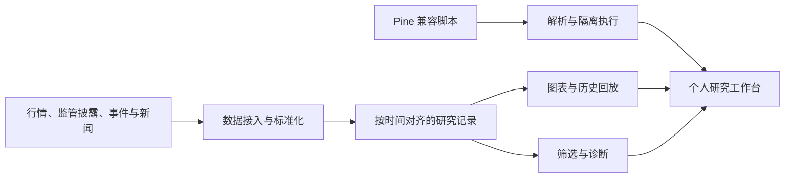

[English](README.md) | [简体中文](README_ZH.md) | [日本語](README_JA.md)

# NuvexLens

### 个人量化研究工作台

面向个人量化研究流程的工程工作台，涵盖多市场图表、历史回放、行情数据研究与脚本实验。

[项目主页](https://nuvexlens.com) · [图表与回放](https://chart.nuvexlens.com/) · [文档](https://docs.nuvexlens.com)

---

> **项目定位：** NuvexLens 是个人量化研究与工程实践工作台，不是商业 SaaS、付费信号服务、投资顾问、经纪商或交易执行平台。本仓库用于展示经过筛选和脱敏的项目架构与工程材料。核心模型逻辑、凭据、个人数据、生产配置及具体数据源管线细节保留在私有环境。

## 项目概览

NuvexLens 将多市场图表、历史回放、研究数据流程、筛选分析与脚本实验整合到个人研究工作流中。重点是构建可复核的量化研究工程流程，而非公开发布交易推荐或专有因子配方。

## 概念架构

此图展示逻辑关系，不代表线上部署拓扑；不包含数据供应商地址、数据库 Schema、模型公式或生产架构细节。

## 工程方向

### 图表与回放

- 支持多个图表视图联动，用于比较标的与周期。
- 提供历史回放、逐步推进和变速控制。
- 双盲回放可遮蔽标的与日期线索，以降低后视偏差。它是研究控制手段，不代表所有计算都已证明不存在未来数据影响。

### 研究数据流程

- 将行情、监管披露、事件与新闻等异构输入标准化，支撑研究流程。
- 区分源数据、衍生观察值与评估结果。
- 具体数据源适配器、私有 Schema、特征定义和因子权重不纳入公开展示。

### 脚本实验

- 解析并转换 Pine 兼容脚本，交由隔离执行链路运行。
- 专有指标逻辑和生产执行细节保留在私有环境。

### 历史评估

- 使用历史数据和跟踪结果复核研究假设。
- 回测与模拟结果属于研究证据，不构成未来表现承诺。

## 公开仓库范围

本仓库仅展示项目说明、概念架构和经过筛选及脱敏的演示材料。新增截图或录屏前，应清除账号标识、个人自选列表、私有持仓、会话信息及其他非公开数据。

本仓库当前没有统一适用于所有内容的开源代码许可证。仓库公开可见不等于授予复用许可；第三方组件与脚本仍受各自条款和许可证约束。

## 声明

NuvexLens 的用途限定为个人量化研究与工程实践；其中的工具和模拟结果属于研究材料，不构成个性化投资建议、经纪服务、交易执行或面向公众的付费信号服务，也不保证投资结果。

图表体验集成 TradingView Charting Library 及相关组件，并遵循其适用条款。感谢 TradingView 团队及脚本作者社区的工作。

---

**NuvexLens** — 个人量化研究工作台

Copyright © 2024-2026 NuvexLens. 保留所有权利。

